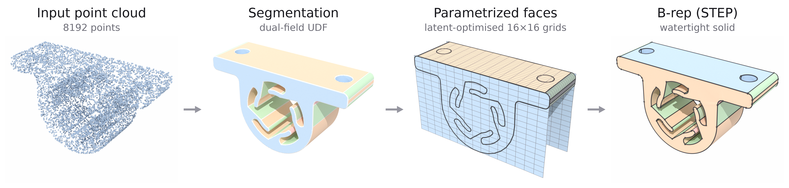
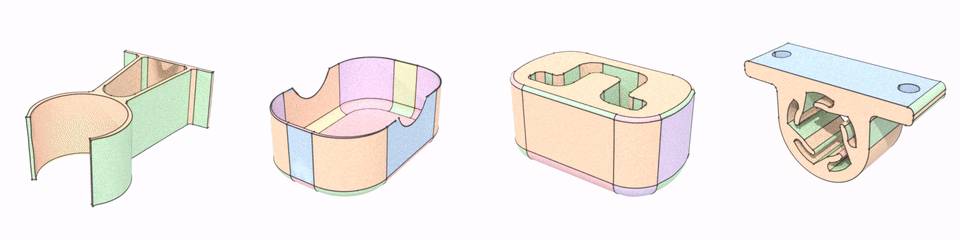

# DualBrep — Reconstruction & Generation Inference

Official implementation of **DualBrep: A Dual-Field Continuous Representation for B-rep Modelling**
(Yilin Liu, Pradeep Jayaraman, Chinthala Reddy, Xiang Xu, Hooman Shayani), to appear at
**SIGGRAPH 2026** — [arXiv:2606.31579](https://arxiv.org/abs/2606.31579). If you use this code,
please [cite it](#citation).

<p align="center">
  
</p>

<p align="center">
  
</p>

*Top: the pipeline on test shape 00013293 — input point cloud → segmentation of the dual-field UDF →
latent-optimised 16×16 face grids → watertight B-rep (STEP). Bottom: four complex free-form test shapes
rebuilt from their point clouds
([full-quality MP4](assets/dualbrep_brep_turntable_row.mp4)).*

Boundary Representation (B-rep) is the dominant data format in Computer-Aided Design (CAD), prized
for its analytical precision and native support for parametric editing. Its heterogeneous
structure, however — continuous parametric geometry coupled with a discrete topological graph —
makes it difficult for deep learning: methods that predict the B-rep graph directly rely on
fixed-size padding or sequential tokenization, which scale poorly with the combinatorial
complexity of CAD models and cannot be optimized end-to-end for geometry and watertightness.

**DualBrep** sidesteps this by encoding a CAD model as two continuous scalar fields over a shared
Euclidean domain: a **signed distance field (SDF)** capturing the global shape geometry, and an
**unsigned distance field (UDF)** that encodes topology implicitly through a Voronoi partition of
the surface. Compressing both fields into a single latent keeps the representation primitive-free —
it adapts to arbitrary face counts and surface types — and lets a **flow-matching** model sample
geometry and topology jointly from one code, avoiding the error accumulation that afflicts
sequential B-rep predictors. A neural **rebuilder** then extracts an explicit, watertight B-rep,
spanning both prismatic and free-form faces, directly from the continuous dual fields. The result
is a robust backbone for CAD learning, with strong results on point-cloud reverse engineering and
generative modelling.

This repository provides the **inference** pipeline: it turns an unstructured mesh (or a point
cloud / single RGB image) into a watertight, parametric **B-rep** (STEP file), covering both
**reconstruction** (autoencoding) and **generation** (point-cloud- or image-conditioned flow).

## Release progress

- [x] **Checkpoints**: autoencoders, point-cloud and image flow models, and the parametrizer
- [x] **Inference code** with sample inputs
- [x] **Evaluation code**
- [x] **VAE pipeline**: encode a B-rep (STEP) into a latent and decode it back
- [x] **Full test results**

> **Update — 11 October 2026**
>
> - [x] 🆕 **Latent optimizer**: test-time optimisation of the parametrizer's per-face latents, so that
>   adjacent faces meet before the B-rep is built ([details](#rebuild-details))
> - [x] 🆕 **Upgraded rebuilder**: runs on pythonocc-core 8.0.1.1, builds each candidate without its own
>   geometry optimisation first (so the optimised latents are kept), and closes the holes left by faces
>   that cannot be trimmed ([details](#rebuild-details))
> - [ ] **Training scripts and data pipeline**: will not be released, because the original models were
>   trained on a distributed system.

# Install

A single conda environment:

```bash
conda create -n Dualbrep python=3.12 -y
conda activate Dualbrep
conda install -c conda-forge pythonocc-core=8.0.1.1 -y
pip install -r requirements.txt
```

Then download the checkpoints from [🤗 ADSKAILab/DualBrep](https://huggingface.co/ADSKAILab/DualBrep)
and unzip them into this folder. The **quick start** needs only `checkpoints/` (the demo point
clouds in `sample/` ship with the repo); the **full test set** (`data/`) is only needed to
reproduce the paper results.

```bash
pip install -U "huggingface_hub[cli]"
hf download ADSKAILab/DualBrep checkpoints.zip --repo-type model --local-dir .
unzip checkpoints.zip      # -> checkpoints/
```

```
DualBrep/
├── assets/        dualbrep_pipeline_wide.png  dualbrep_brep_turntable_row.gif/.mp4   # README figure and video
├── sample/        00013293.ply  00021127.ply  00026543.ply  00030157.ply   # bundled demo point clouds
├── sample_imgs/   00013293.png  00021127.png  00026543.png  00030157.png   # bundled demo conditioning images
├── checkpoints/   ae_vae.ckpt  pc_vae.ckpt  pc_flow.ckpt  img_flow.ckpt  parametrizer.ckpt
└── data/          pc/  imgs/  gt_seg/  final_test.txt   # full 4150-shape test set
```

# Introduction of the pipeline

```
Input mesh / point cloud / image
   └─ AE  or  diffusion + VAE decoder      (ae_reconstruct.py / vae_generate.py)
        └─ SDF / UDF fields  →  surface mesh (recon_sdf.ply) + edge/wireframe (recon_udf.ply)
             └─ segmentation                (clustering.py)        →  segmented mesh (cluster.ply)
                  └─ Parametrizer            (rebuild.py)           →  per-face UV grids + edges + connectivity (tmp/<name>_<k>/post.npz)
                       (+ latent optimisation: the decoded faces are made to meet)
                       └─ Rebuilder          (postprocess.py)       →  watertight B-rep (<name>.step + <name>.ply)
```

| Stage | Script | Output |
|-------|--------|--------|
| AE reconstruction (SDF/UDF) | `ae_reconstruct.py` | `recon_sdf.ply`, `recon_udf.ply`, `sdf_g.npy`/`udf_g.npy`, `norm_params.npz` (PC path) |
| Diffusion generation (PC / image → SDF/UDF) | `vae_generate.py` | same, conditioned |
| Segmentation (B-rep faces) | `clustering.py` (via the above) | `cluster.ply` |
| Parametrizer (UV grids + topology) | `rebuild.py` (+`rebuild_model.py`) | `tmp/<id>_<k>/post.npz` |
| Rebuilder (assemble solid) | `postprocess.py` (+`brep_post/`) | `<name>.step` + `<name>.ply` |

What the parametrizer and the rebuilder do in detail, their cost, and results on the test set:
[Rebuild details](#rebuild-details).

# Quick start on sample data

`run_pipeline.sh` runs the whole chain on the **bundled `sample/` point clouds** — 4 shapes that
reconstruct into valid solids, needing only `checkpoints/` (no `data/` download required).

The quick start uses the **point-cloud autoencoder** (`DualVAE_PC`, `pc_vae.ckpt`) to perform
**direct shape reconstruction and segmentation** — it encodes each input point cloud and decodes
the SDF/UDF fields (a single encode→decode pass, **no diffusion / generation**), meshes the
surface, and segments it into B-rep faces. The segmented mesh is then parametrized and rebuilt
into a watertight solid:

```
point cloud ──(AE encode→decode)──▶ SDF/UDF ──▶ surface mesh + segmentation (cluster.ply)
            └──▶ parametrize (per-face UV grids + edges) ──▶ rebuild ──▶ watertight B-rep (STEP)
```

```bash
./run_pipeline.sh
# overridable: CONFIG=config.yaml (implicit AE, from precomputed .npz)  OUT=out  ROTATIONS=all  TEST_RES=256
#              NPROC=16   parametrizer processes sharing the GPU (through CUDA MPS when nvidia-cuda-mps-control exists)
#              NUM_CPUS=  rebuilder CPUs (default: all cores)
```

Results land in `output_pipeline/` — `recon/<name>/cluster.ply` and one valid B-rep per shape
`brep/<name>.step` + `brep/<name>.ply` (the 24 rotation candidates are kept under `brep/tmp/`).
All 4 sample shapes seal (75-76 of the 96 rotation candidates in our runs).

# Reproduce main results

Run the **same point-cloud autoencoder pipeline as the quick start**, but on the full test set
(4150 shapes, listed in `data/final_test.txt`) instead of the bundled samples. First download the
test-set archive from HuggingFace and unzip it into `data/` — it contains the input point clouds,
the shape list, and the ground-truth segmentation used by [Evaluation](#evaluation):

```bash
hf download ADSKAILab/DualBrep test_data.zip --repo-type model --local-dir .
unzip test_data.zip      # -> data/  (pc/  gt_seg/  final_test.txt  ...)
```

Then run the pipeline:

```bash
# 1) point-cloud AE (DualVAE_PC / pc_vae.ckpt): direct reconstruct SDF/UDF + segment, at 256^3
python ae_reconstruct.py config=config_pc.yaml \
    dataset.data_root=data/pc dataset.name_list=data/final_test.txt runtime.test_res=256
#   -> per shape under output_pc/: recon_sdf.ply / recon_udf.ply / udf_g.npy / cluster.ply

# 2) parametrize each segmented mesh: 24-rotation test-time augmentation + latent optimisation (GPU)
python rebuild.py --input output_pc --out output_brep

# 3) assemble the B-rep
python postprocess.py --input output_brep
```

Step 2 takes 10-15 s per rotation candidate in one process, so for the 4150 shapes run several
processes on one GPU through CUDA MPS, each with its own shard (this is what `run_pipeline.sh` does):

```bash
nvidia-cuda-mps-control -d
for i in $(seq 0 15); do python rebuild.py --input output_pc --out output_brep --shard $i/16 & done; wait
echo quit | nvidia-cuda-mps-control
```

# Rebuild details

| Stage | What it does |
|---|---|
| Segmentation | `clustering.py` drops clusters below 100 triangles (`filter_size`): mostly slivers along edges, which rarely seal |
| Parametrizer | `rebuild.py` drops predicted edges between faces whose clusters are clearly apart in `cluster.ply` (no vertex within 0.05) |
| Parametrizer | `rebuild.py` then optimises the per-face latents of each rotation candidate so that adjacent faces meet: each decoded edge lies on both of its faces and passes through the input points along the boundary, the two half-edges of an adjacency coincide, and the edges of a face meet at its corners, while the faces stay on their input points (200 Adam steps; face sampling seeded per rotation) |
| Rebuilder | `postprocess.py` builds each candidate first without the geometry optimisation that precedes surface fitting (which moves edges to fit face samples 0.05 apart and would undo the agreement reached above); only if that gives no solid, with it, and if still no tolerance seals the candidate, the holes left by faces that could not be trimmed are closed with n-sided patches (`BRepOffsetAPI_MakeFilling`) |
| Rebuilder | each candidate is seeded (reproducible); per shape, rotations sealed without patches are preferred, and among the sealed rotations with the same vertices as the first one, the one with the smallest gap between faces is promoted |

Cost: the latent optimisation takes 10-15 s per rotation candidate in one process. Several processes
can share one GPU through CUDA MPS, each with `--shard k/n`: 24 processes on one NVIDIA L40S optimised
the 2400 candidates of 100 shapes × 24 rotations in 52 minutes. The time grows with the number of
faces: generated shapes with 55-120 faces took 2-4 times longer per candidate than these test shapes.
The rebuilder takes 20-50 s per candidate on one CPU core.

Results on the first 100 shapes of `data/final_test.txt` (point-cloud AE at 256³, 24 rotations; F1 from
[`eval_seg.py`](#evaluation), a shape without a solid scores 0):

| valid solids | F1 surface / edge / vertex | gap median |
|---|---|---|
| 85 | 0.708 / 0.662 / 0.615 | 5.8e-3 |

- *Valid solid*: the rebuilder's own check — one solid that passes `BRepCheck` with every tolerance set
  to 0.1 (shapes are in the unit box).
- *Gap*: how far apart the faces of a solid really are — all tolerances are reset and raised only as
  far as OpenCASCADE needs (`BRepLib` `SameParameter` + `UpdateTolerances`), and the gap is the largest
  resulting tolerance.
- Measured with pythonocc-core 8.0.1.1. The latent optimisation on the GPU is not bit-for-bit
  repeatable, and the rebuilder's geometry optimisation gives slightly different results on different
  machines, so reruns can differ by a few shapes. `eval_seg.py` meshes and samples each predicted face,
  so its scores also vary a little between runs and OpenCASCADE versions (here by up to 0.002 in the
  mean F1).

# Evaluation

`eval_seg.py` scores a reconstructed B-rep against the ground-truth B-rep segmentation of the
ABC test set.

- **Input:** `--pred` a directory of your pipeline's predicted B-reps (STEP files), `--gt` the
  ground-truth segmentation directory, and `--list` the shape names to score.
- **Output:** a per-element accuracy report, printed and cached per shape under `--out`.

Each predicted solid is decomposed with OpenCASCADE into faces / edges / vertices and their
topology, then compared to the ground truth. It reports, per structural element
(**surface / edge / vertex**): **F1 / precision / recall** — Hungarian matching of per-element
point groups, a pair counting as matched when its symmetric point-to-point distance is below
`0.1` (shapes are in the unit box) — plus the **chamfer distance**; and for topology,
**face-edge** and **edge-vertex** adjacency F1 / precision / recall.

The ground truth lives in `data/gt_seg/` — one `<name>.ply`, `<name>_edge.ply`,
`<name>_vertex.ply`, `<name>_adj.npz` per shape. It ships in the **same data archive** as the
`data/pc/` point clouds and `data/final_test.txt` from [Reproduce main
results](#reproduce-main-results), so if you ran that step it is already in place.

```bash
# score your pipeline output (flat brep/<name>.step layout) against the ground truth
python eval_seg.py --pred output_pipeline/brep --gt data/gt_seg \
    --list data/final_test.txt --out eval_out

# quick test on just the first 100 shapes
python eval_seg.py --pred output_pipeline/brep --gt data/gt_seg \
    --list data/final_test.txt --limit 100 --out eval_out
```

The predicted STEP is looked up per shape at the first of `<pred>/<name>/pp/recon_brep.step`,
`<pred>/<name>/recon_brep.step`, `<pred>/<name>.step`, `<pred>/brep/<name>.step`. Shapes with no
sealed STEP score zero and are counted in the reported failure rate. Evaluation is Ray-parallel
(`--num-cpus`, or `--serial` to debug); per-shape results are cached to `--out` as
`<name>_eval.npz`, and `--report-only` re-aggregates them without recomputing.

# Detailed use case

## VAE: encoding a B-rep into a continuous vecset latent and decode it back

The input is a **B-rep (STEP file)**. `ae_reconstruct.py` (the dual-field autoencoder `DualVAE`,
checkpoint `ae_vae.ckpt`) encodes sample points taken on the solid's **surface**, **edges**, and
**Voronoi diagram** into a vecset latent, then decodes an **SDF** (watertight surface) + a **UDF**
field (unsigned distance to the **Voronoi diagram** that separates adjacent faces) and segments
the surface into B-rep faces. The sample points come from a precomputed `.npz` — you can either
use the **bundled examples** (A) or **compute them from your own STEP** (B).

### A) Bundled examples (quick start)

Four precomputed `.npz` (`00013293`, `00021127`, `00026543`, `00030157` — the same shapes as the
demo point clouds) are packaged as `implicit_test.zip` on HuggingFace. Download and unzip them
into `sample/` (they are too large to ship in the repo):

```bash
hf download ADSKAILab/DualBrep implicit_test.zip --repo-type model --local-dir .
unzip implicit_test.zip -d sample/      # -> sample/00013293.npz  00021127.npz  ...
python ae_reconstruct.py                # implicit defaults: data_root=sample, sample_shapes.txt, ae_vae.ckpt
```

### B) From your own STEP (compute the samples)

Derive the `.npz` from any STEP solid in three steps — compute the Voronoi field (C++), collect
the samples (Python), then encode/decode. Point the commands below at your own STEP file (the
examples use `00000164.step`).

**1) Voronoi field (C++, `Voronoi/`).** `calculate_voronoi` reads a STEP, normalizes it into the
`[-0.9, 0.9]` box, and writes the Voronoi mesh `voronoi.ply` (plus `normalized_mesh.ply` and
`sampled_points.ply`). Build it once (needs vcpkg — CGAL / OpenCASCADE / Geogram / glog):

```bash
cd Voronoi
./install.sh                     # apt deps + clones GTE/vcglib + vcpkg installs the C++ libs
cmake -B build -S . -DCMAKE_TOOLCHAIN_FILE=external/vcpkg/scripts/buildsystems/vcpkg.cmake
cmake --build build --config Release -j
cd ..
Voronoi/build/calculate_voronoi/calculate_voronoi 00000164.step out/00000164/
```

**2) Collect implicit samples (`prepare_implicit.py`).** Turns the STEP + `voronoi.ply` into the
`.npz` the VAE consumes (surface/edge/voronoi point clouds + SDF/UDF query fields):

```bash
python prepare_implicit.py --step 00000164.step --voronoi out/00000164/voronoi.ply \
    --out implicit/00000164.npz
# batch:  python prepare_implicit.py --step-dir steps/ --voronoi-dir voronoi/ --out-dir implicit/
```

**3) Encode → latent → decode (`ae_reconstruct.py`).** Point the AE at your `.npz` folder:

```bash
python ae_reconstruct.py dataset.data_root=implicit dataset.name_list=null \
    runtime.output_dir=output runtime.test_res=256
```

## Shape generation: point-cloud- or image-conditioned

`vae_generate.py` runs the rectified-flow generator (conditioning → DiT flow noise→latent →
frozen `DualVAE` decode → SDF/UDF → mesh → segment):

| Mode | Input | Encoder | Config | Checkpoint |
|------|-------|---------|--------|------------|
| `pointcloud` | `.ply` (oriented; all verts used) | `PCModel2` | `config_gen_pc.yaml` | `pc_flow.ckpt` |
| `image` | one RGB render | DINOv2 (`ImgModel`) | `config_gen_img.yaml` | `img_flow.ckpt` |

```bash
# point cloud → shape (bundled sample/ clouds)
python vae_generate.py config=config_gen_pc.yaml  dataset.data_root=sample      dataset.name_list=null
# single image → shape (bundled sample_imgs/; downloads DINOv2 ~1.1 GB on first run)
python vae_generate.py config=config_gen_img.yaml dataset.data_root=sample_imgs dataset.name_list=null
```

Each run writes `recon_sdf.ply` / `recon_udf.ply` / `cluster.ply` per shape, the same layout the
autoencoder produces — so a generated shape feeds the identical `rebuild.py` → `postprocess.py`
pipeline to become a watertight B-rep.

Generation is **stochastic**: each run samples a fresh latent from noise, so (unlike the
autoencoder) a single pass is not guaranteed to seal. Draw several samples per condition, run
each through the parametrizer (`rebuild.py`: 24-rotation test-time augmentation + latent
optimisation) and `postprocess.py`, then keep the samples that assemble into a valid solid:

```bash
# draw N stochastic samples per condition (each run re-samples from noise), and
# parametrize (24 rotations) + assemble each; keep whichever samples seal
for i in $(seq 0 7); do
  python vae_generate.py config=config_gen_pc.yaml \
      dataset.data_root=sample dataset.name_list=null runtime.output_dir=gen_out/s$i
  python rebuild.py     --input gen_out/s$i --out gen_brep/s$i
  python postprocess.py --input gen_brep/s$i
done
# gen_brep/s<i>/<name>.step is sample i's B-rep (if it sealed); pick a valid one per shape
```

Not every sample seals. On the four bundled demo shapes, drawing 8 samples × 24 rotations each,
**point-cloud** conditioning sealed a valid `BRepCheck` solid for **all four** shapes (27 of the 32
samples), while **single-image** conditioning sealed three of them (18 of 32 samples) but never the
most detailed part, `00013293` — image conditioning tends to over-segment complex geometry (its
samples of `00013293` had about 120 B-rep faces), which seldom sews watertight. Point-cloud conditioning, which sees full 3D geometry, is more
reliable. Keep any sample whose B-rep passes `BRepCheck`; if a detailed shape never seals, draw
more samples.

## Mesh segmentation: segment an input mesh with a Voronoi into B-rep faces

`clustering.py` (invoked automatically when `runtime.compute_clustering=true`) segments the
reconstructed surface using the per-face UDF (unsigned distance to the nearest B-rep edge,
stored in `udf_g.npy`). The default `hierarchical` mode is a two-pass threshold +
connected-components region grow (reproducing the C++ `segment_mode3` baseline): pass 1 keeps
faces whose UDF is above a threshold and labels their connected components (low-UDF faces near
edges are left unlabelled as boundaries), then drops clusters smaller than `filter_size` (100
triangles); pass 2
re-splits any cluster whose faces exceed a second, higher UDF threshold. The result is aligned
with **B-rep faces** (one cluster per smooth face bounded by sharp edges), *not* semantic parts.
It writes `cluster.ply` (per-face `label`), and can be re-run on existing folders:

```bash
python clustering.py output/      # each folder needs recon_sdf.ply + (udf_g.npy OR a dense recon_udf.npy)
```

## Parametrization: segmented triangle soup → UV grids → trimmed, assembled B-rep

Two steps turn the segmented mesh into a valid solid.

**Parametrizer — `rebuild.py`** (`Parametrizer`, `parametrizer.ckpt`). Samples each labelled
face (100 pts + normals), re-fits it as a 16×16 parametric surface grid, and predicts the
face-face **intersection edges + topology**, written to `post.npz`. `--rotations all`
re-poses the mesh by each of the 24 octahedral rotations `M[k]` (index 3 = identity) into
`tmp/<id>_<k>/` — where `<id>` is the shape id (the recon folder name up to its first `_`, so
recon dir `00013293_3` yields `tmp/00013293_00/ … tmp/00013293_23/`) and `<k>` is the rotation
`postprocess.py` reads back to undo the pose. Test-time augmentation: many more candidates seal
than a single pose (`--rotations`, default all 24). Predicted edges between faces whose clusters are
clearly apart in `cluster.ply` are dropped, and the per-face latents of each candidate are then
optimised so that adjacent faces meet (see [Rebuild details](#rebuild-details)); the loss terms of
each candidate, before and after, go to `latent_opt.jsonl` in the output folder
(`latent_opt_<i>.jsonl` for shard `i/n`).

```bash
python rebuild.py --input <recon_dir>          --out output_brep
python rebuild.py --input <name>/cluster.ply   --out output_brep
# knobs: --rotations all  --lopt_steps 200  --lopt_lr 2e-3  --lopt_w move=1 vert=1 ...  --num_fit_points 400
#        --shard k/n (process every n-th shape, for several processes on one GPU)
```

**Rebuilder — `postprocess.py`** (OpenCASCADE). Fits a trimmed B-spline surface per face,
sews edges into wires/faces, and sews the faces into a **watertight solid**; it undoes each
candidate's rotation with `inv(M[k])`. Each face boundary is first closed with a tolerance-based
wire builder; if that leaves an open loop (common on large faces bordered by many edges, where no
single tolerance both bridges the widest junction gap and avoids over-merging nearby vertices), a
fallback re-assembles the loops by ordered endpoint chaining and welds the gaps. Candidates are assembled in parallel with **Ray** (one
CPU each, seeded so a rebuild is reproducible). Each candidate is built without the geometry
optimisation first, and only if that fails with it and hole filling (see
[Rebuild details](#rebuild-details)). For every shape one sealed rotation is promoted to
`<name>.step` + `<name>.ply` (triangulation) in the output folder — rotations sealed without patches
first, and among the rotations with the same vertices as the first sealed one, the one with the
smallest gap between faces. The 24 candidates stay under `tmp/`.

```bash
python postprocess.py --input output_brep          # Ray parallel by default
# knobs: --num_cpus 16  --serial  --max_optimize_iter 200  --drop_num 0  --timeout 1200  --seed 0 (-1: unseeded)
```

Across rotations, about two thirds of the candidates seal into closed 1-solid STEPs (`BRepCheck`
valid; first 100 test shapes); one is kept per shape.

# Citation

This repository is the official implementation of our SIGGRAPH 2026 paper
([arXiv:2606.31579](https://arxiv.org/abs/2606.31579)). If you use this code or the ideas in the
paper, please cite:

```bibtex
@article{liu2026dualbrep,
  title         = {DualBrep: A Dual-Field Continuous Representation for B-rep Modelling},
  author        = {Yilin Liu and Pradeep Jayaraman and Chinthala Reddy and Xiang Xu and Hooman Shayani},
  journal       = {Proc. SIGGRAPH},
  year          = {2026},
  eprint        = {2606.31579},
  archivePrefix = {arXiv},
  primaryClass  = {cs.GR},
  url           = {https://arxiv.org/abs/2606.31579}
}
```
